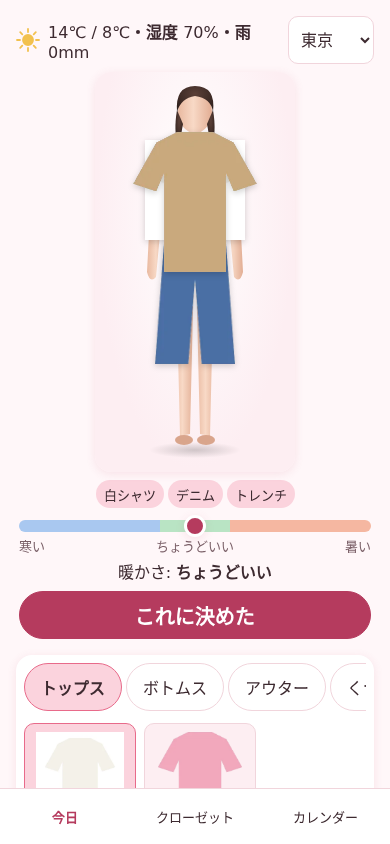
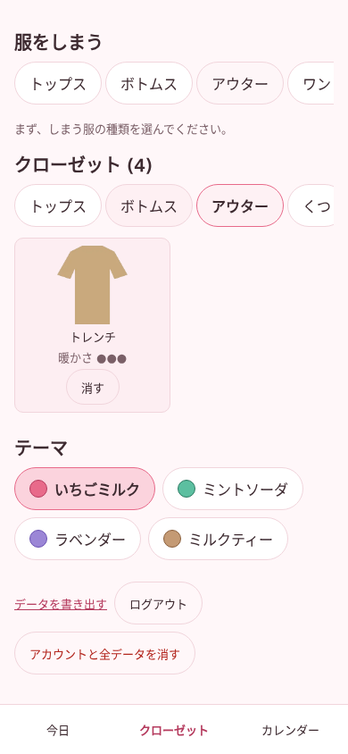
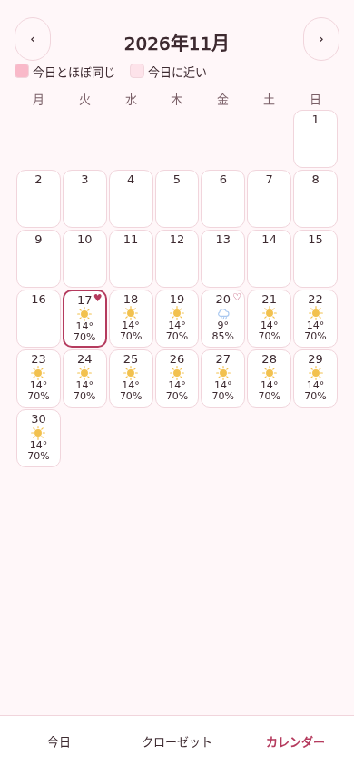

# kisekae-closet

自分の服の写真をアバターに着せ替えて、今日の天気に合うコーデを朝 30 秒で決める

**https://kisekae-closet.wakuwaku-factory.workers.dev/**

## これは何
開くと今日の天気とおすすめを着たアバターが出て、クローゼットから服を引っ張り出して着せ替え、ワンタップで今日のコーデに決められる

## 使い方

1. 「はじめる」でパスキーを作る (パスワードもメールも要りません)
2. 「クローゼット」で服の種類を選び、ハンガーにかけた服を正面から撮って、暖かさとラベルを付けてしまう
3. 「今日」を開くと、今日の天気に合うおすすめをアバターが着ています。下の棚から服を引っ張り出して (ドラッグかタップ) 着せ替え、「これに決めた」
4. 「カレンダー」で決めた日の ♥ と天気が見られます。15 日先までの日を押すと、予報を見ながらその日のコーデを先に決めておけます (♡)
5. 色はクローゼットの下の「テーマ」で、いちごミルク・ミントソーダ・ラベンダー・ミルクティーから選べます

| 今日 | クローゼット | カレンダー |
| --- | --- | --- |
|  |  |  |

画像は `npm run shots` で撮り直せます (手元の wrangler dev と D1 で e2e を流し、canvas で描いた服の絵を使う。人の写真は使いません)。

## データについて

ログインはパスキーだけです。パスワードもメールアドレスも名前も持ちません。
サーバーに置くのは、ランダムな利用者 ID・パスキーの公開鍵・登録した服 (写真)・コーデと、その日の気温と湿度の数字だけです。
写真は送る前に端末で縮め、撮った場所などの情報を消します。場所はサーバーに送りません。
「データを書き出す」でいつでも取り出せ、「アカウントと全データを消す」で全部消えます。詳しくは [DATA.md](DATA.md)。

## 開発

```bash
npm ci
npm run db:local # 手元の D1 (SQLite) に migrations を流す
npm run dev      # 画面だけ (vite)。API ごと動かすなら npm run build && npx wrangler dev
npm run verify   # lint・型・テスト・ビルド・守りの検査
npm run e2e      # ブラウザでの検査 (wrangler dev と手元の D1、仮想の認証器でパスキー)
npm run bundle   # 配る形 (dist/ と bundle/worker.js)。wk deploy が使う
```

Cloudflare Workers と D1 で動いています。

---

[wakuwaku factory](https://github.com/Rin0107/ideas) が自動で作りました (アイディア: `00502-kisekae-closet`)。
